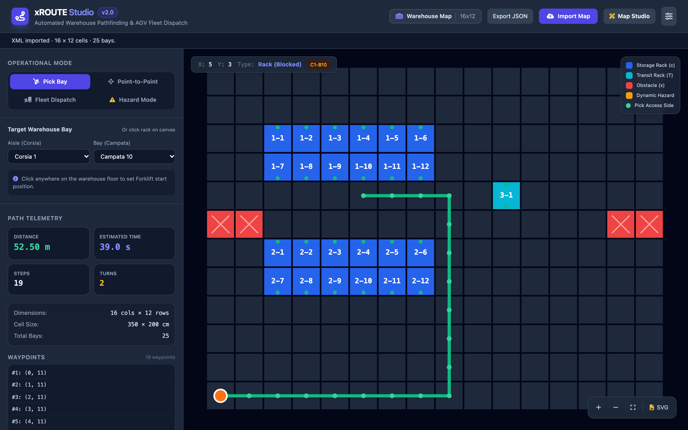

<h1 align="center">xROUTE</h1>

<p align="center"><strong>Deterministic warehouse routing in portable C99.</strong><br>
Directed aisles, rack access, turn penalties, dynamic obstacles, and fleet dispatch<br>
with a small C ABI, a command-line tool, Python bindings, and a local Studio UI.</p>

<p align="center">
  
</p>

<p align="center">
  <a href="https://github.com/KOKUTBON/xROUTE/actions/workflows/ci.yml"></a>
  <a href="LICENSE"></a>
  <a href="https://en.wikipedia.org/wiki/C99"></a>
</p>

xROUTE builds an in-memory directed grid from warehouse maps and answers shortest-path queries on demand. A* uses physical cell dimensions as its heuristic; optional heading-aware state expands the search when turn penalties are enabled. No distance-vector files or precomputed all-pairs matrices are produced.

## What is included

- C99 core: map topology, A* routing, rack/bay access, one-way movement, dynamic obstacles, turn penalties, and fleet dispatch.
- Import/conversion: XML (`Magazzino`/`Deposito`), legacy CSV, JSON, TSV, coordinate tables, and ASCII grids. See [supported formats](Docs/IMPORTS.md).
- Interfaces: `include/xroute/xroute.h`, `bin/xroute`, Python `ctypes` bindings, and the local xROUTE Studio UI.
- Tests: deterministic native unit tests plus Python importer, lifecycle, HTTP, and validation tests.

## Build and test

Requirements are a C99 compiler, `make`, and Python 3.9+. The native library has no mandatory runtime dependency.

```sh
make all
make check
make benchmark
```

`make check` runs the C and Python tests. `make sanitizer` runs the native suite with AddressSanitizer and UndefinedBehaviorSanitizer when supported. `make format-check` checks the C sources when `clang-format` is installed.

Modern CMake presets (`debug`, `release`, and `asan`) are configured in `CMakePresets.json`:

```sh
# Build and test with AddressSanitizer & UndefinedBehaviorSanitizer
cmake --preset asan
cmake --build --preset asan
ctest --preset asan

# Optimized release build
cmake --preset release
cmake --build --preset release
ctest --preset release
```

Standard manual CMake builds are also supported:

```sh
cmake -S . -B build/cmake
cmake --build build/cmake
ctest --test-dir build/cmake --output-on-failure
```

## Reproducible benchmark

Run:

```sh
make benchmark
# equivalent:
bin/xroute bench --map examples/maps/warehouse.xml 5000
```

The command reports the actual run rather than a fixed marketing number. It records the map path and dimensions, query count, successful paths, median query time, p95 query time, and mean throughput. Queries use a deterministic `rand()` seed of 42 and uniformly sampled start/goal cells; route allocation and release are included in each sample. Results depend on the machine and workload.

For a report that can be compared or published, record hardware/CPU, OS, compiler and flags, map dimensions and cell scale, query count and success count, seed and sampling method, allocation policy, and median/p95 plus mean throughput. The bundled `examples/maps/warehouse.xml` is the baseline map for `make benchmark`; it is intentionally small and versioned so the benchmark is reproducible from a clean checkout.

## C API

```c
#include "xroute/xroute.h"

xroute_map_t *map = NULL;
if (xroute_map_load_xml("examples/maps/warehouse.xml", &map) != XROUTE_SUCCESS)
    return 1;
xroute_router_t *router = xroute_router_create(map); /* borrows map */
xroute_options_t options = xroute_default_options();
options.turn_penalty_cost = 50;

xroute_route_t *route = NULL;
xroute_status_t status = xroute_router_find_path(
    router, (xroute_point_t){0, 0}, (xroute_point_t){10, 11},
    &options, &route);
if (status == XROUTE_SUCCESS)
    xroute_route_free(route); /* route and route->points are caller-owned */
else if (status == XROUTE_ERR_NO_PATH)
    ; /* valid but blocked or disconnected */

xroute_router_free(router); /* does not free map */
xroute_map_free(map);
```

Maps and routers are opaque. A router borrows its map, so the map must outlive it. Routes returned through `out_route` are caller-owned and must be released with `xroute_route_free`. Fleet results own their returned route and are released with `xroute_fleet_result_free`. Accessor arrays returned by the map API are borrowed and must not be freed. Invalid coordinates return an error; unreachable paths return `XROUTE_ERR_NO_PATH` and leave output routes null.

The public API exposes `xroute_map_set_dynamic_obstacle`, directional movement masks for one-way aisles, and `turn_penalty_cost`/`turn_time_sec` for kinematic costs. See the headers in [`include/xroute`](include/xroute) and [architecture notes](Docs/ARCHITECTURE.md).

## Python API

```python
from xroute import Warehouse

with Warehouse.load("examples/maps/warehouse.json") as warehouse:
    route = warehouse.find_path((0, 0), (6, 4), turn_penalty_cost=50)
    print(route.points, route.distance_meters, route.turns)
    warehouse.set_dynamic_obstacle(3, 2, is_blocked=True)
```

`Warehouse` owns the native map and router and is context-manager safe. `Route` is a Python-owned copy of the native result. Import validation rejects malformed, oversized, ragged, duplicate, and out-of-bounds inputs before native allocation. Batch validation and conversion are available with `PYTHONPATH=python python -m xroute`; the same validated pipeline powers Studio.

## CLI and Studio

```sh
bin/xroute route --map examples/maps/warehouse.xml --start 0,0 --goal 10,11 --visualize
bin/xroute bay --map examples/maps/warehouse.xml --start 0,0 --corsia 1 --campata 12
bin/xroute fleet --map examples/maps/warehouse.xml --corsia 1 --campata 12 --forklifts 0,0 5,8
make studio
```

Studio is a local planning and visualization tool, not a collision-avoidance controller or authenticated production service. It can import maps, add temporary hazards, route to bays, dispatch a fleet, and export SVG.

## Static browser demo

Run `make demo-check demo-serve` to preview Studio at `http://localhost:8080` with
browser-side mocks for every API endpoint. No native backend is required; routes,
fleet dispatch, imports, and hazards remain interactive. `make demo` produces the
GitHub Pages site in `build/demo/`. Publishing is manual and opt-in—see the
[demo build and publishing guide](Docs/DEMO.md).

## Documentation

- [Import formats and validation limits](Docs/IMPORTS.md)
- [Architecture and algorithms](Docs/ARCHITECTURE.md)
- [Routing algorithms and kinematics](Docs/ROUTING_ALGORITHMS.md)
- [C headers](include/xroute/xroute.h)
- [C example](examples/basic_usage.c)
- [Studio and CLI visualizations](Docs/images)

## License

MIT. See [LICENSE](LICENSE).

## KOKUTBON community and support

Open technology for the benefit of humankind — built by people, for people, and freely reusable by everyone.

Read [Contributing](CONTRIBUTING.md), [Code of Conduct](CODE_OF_CONDUCT.md), [Support](SUPPORT.md), [Governance](GOVERNANCE.md) and [Security](SECURITY.md). Help sustain the work through [GitHub Sponsors and other contributions](SPONSORSHIP.md). Maintainer release requirements are documented in [Release checklist](RELEASE_CHECKLIST.md).

## Source publication

See [source publication status](SOURCE_PUBLICATION.md) and [local validation record](PUBLICATION_VALIDATION.md) for the initial distribution and remaining release checks.
