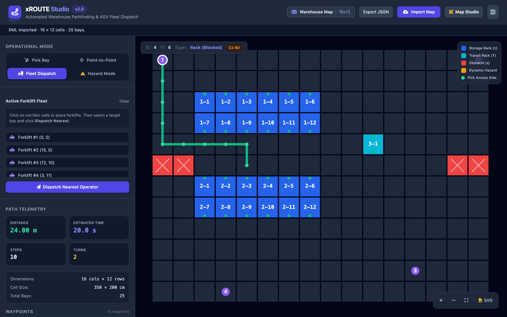

# xROUTE

A warehouse planning tool that finds routes through aisles and helps assign forklift jobs.

[Open the demo](https://kokutbon.github.io/xROUTE/) · [Technical documentation](Docs/ARCHITECTURE.md)

## Features

- Find paths around obstacles and one-way aisles.
- Import warehouse maps and route to storage bays.
- Compare forklift assignments in the Studio interface.

## Screenshots




## Technology

C library and CLI, Python bindings, browser-based Studio, CMake.

## Run the demo locally

```sh
git clone https://github.com/KOKUTBON/xROUTE.git
cd xROUTE
make demo-check demo-serve
```

Open http://localhost:8080/. The browser demo uses sample data. See the technical documentation for the full application setup.

## License

[MIT License](LICENSE).
